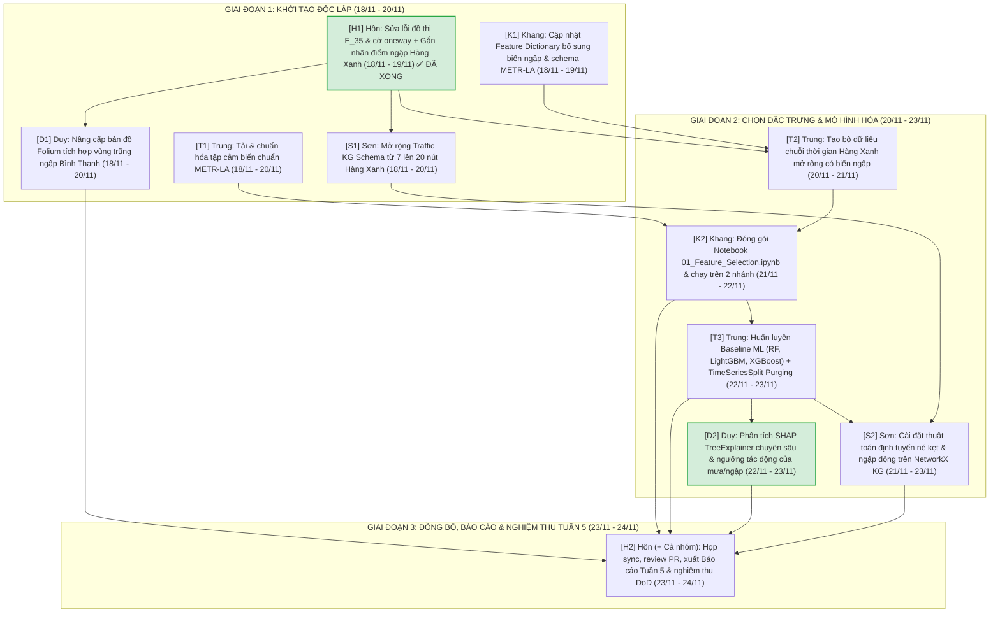

# KẾ HOẠCH THỰC HIỆN ĐỒ ÁN TUẦN 5 (18/11 – 24/11/2026)
## MÔN: MÁY HỌC NÂNG CAO (`CS315.G12.LT.TTNT`) — NHÓM 14

> **Khoảng thời gian:** Thứ Tư `18/11/2026` – Thứ Ba `24/11/2026` (Tuần 5 — Chuẩn hóa 2 nhánh dữ liệu, Hoàn tất Feature Selection & Huấn luyện Baseline ML)  
> **Tài liệu tham chiếu:** [De_Cuong_Chi_Tiet_Do_An_May_Hoc_Nang_Cao.md](./De_Cuong_Chi_Tiet_Do_An_May_Hoc_Nang_Cao.md) | [Ke_Hoach_Thuc_Hien_Tuan_4.md](./Ke_Hoach_Thuc_Hien_Tuan_4.md) | [README.md](./README.md)  
> **Phạm vi tài liệu:** Bản kế hoạch hành động chi tiết của 5 thành viên trong Tuần 5; quy định rõ **Đầu vào (Inputs)**, trạng thái **Phụ thuộc (Chờ ai)**, **Sản phẩm bàn giao (Deliverables)** và **Lưu ý kỹ thuật khắt khe** bám sát Đề cương chi tiết và mục tiêu môn học CS315.  
> **Mục tiêu trọng tâm Tuần 5:**  
> 1. Xử lý triệt để 2 phản hồi GIS của Tuần 4 (`E_35` và cờ `oneway` Nguyễn Gia Trí), bổ sung đặc trưng ngập nước thực tế cho cụm Hàng Xanh.  
> 2. Chuẩn hóa trọn vẹn **2 nhánh dữ liệu** độc lập: Nhánh 1 (`METR-LA` benchmark quốc tế) & Nhánh 2 (Cụm Hàng Xanh TP.HCM kết hợp thời tiết/ngập lụt).  
> 3. Đóng gói dứt điểm module & notebook Google Colab `01_Feature_Selection.ipynb` (Nội dung 2 Đề cương): $\chi^2 > 5.99$ cho nhãn 3 lớp, bảo vệ biến phi tuyến, chống rò rỉ dữ liệu qua fold, nhánh đối chứng PCA độc lập.  
> 4. Huấn luyện đa mô hình Baseline ML (Random Forest, LightGBM, XGBoost) trên 3 chân trời dự báo ($t+15', t+30', t+60'$) với `TimeSeriesSplit` có Purging; thiết lập nền tảng notebook `02_Model_Training.ipynb`.  
> 5. Phân tích giải thích mô hình chuyên sâu bằng `SHAP TreeExplainer` và nâng cấp cấu trúc Đồ thị tri thức (Traffic KG) 20 nút hỗ trợ định tuyến né ngập.

---

## I. SƠ ĐỒ PHỤ THUỘC ĐẦU VIỆC (AI LÀM LUÔN – AI CHỜ AI?)

---

## II. BẢNG TIẾN ĐỘ THỰC TẾ TUẦN 5 (TÍNH ĐẾN 24/11/2026)

| Mã CV | Thành viên phụ trách | Hạn chót | Tiến độ | Trạng thái thực tế & Ghi chú kỹ thuật |
| :---: | :--- | :---: | :---: | :--- |
| **`[H1]`** | **Trần Hoàng Hôn** | `19/11` | **`100%`** | **✅ ĐÃ HOÀN THÀNH (24/11/2026):** Bổ sung cạnh ngược `20 → 17` (`E_38`), đồng nhất cờ `oneway=False` cho cả hai chiều Nguyễn Gia Trí (`E_26`, `E_32`), tích hợp cờ `flood_prone` cho 6 nút & 5 cạnh trũng ngập. Kiểm thử GIS `build_gis_check_map.py` đạt 100%. **Đã mở khóa cho `[T2]`, `[D1]`, `[S1]`.** |
| **`[T1]`** | **Phạm Thành Trung** | `20/11` | `50%` | **Đang thực hiện:** Chuẩn bị script tải & gộp mốc 15 phút tập dữ liệu `METR-LA` (Nhánh 1 đối chứng). |
| **`[K1]`** | **Nguyễn Duy Khang** | `19/11` | `80%` | **Đang hoàn thiện:** `feature_dictionary.md` đã có khung, đang cập nhật bổ sung nhóm biến ngập nước (`flood_prone_node`, `flood_water_level_est`) và schema METR-LA. |
| **`[S1]`** | **Hoàng Cao Sơn** | `20/11` | `80%` | **Đang hoàn thiện:** Đã có prototype `traffic_kg_schema.py` 24 nút (20 intersection + 4 context); đã kết nối thành công với bộ đồ thị mới của `[H1]`. |
| **`[D1]`** | **Vũ Văn Duy** | `20/11` | `70%` | **Đang hoàn thiện:** Bản đồ `hang_xanh_gis_check.html` đã chạy sạch 100% với đồ thị mới của `[H1]`, đang nâng cấp module `build_hang_xanh_gis_advanced.py` tích hợp layer vùng ngập. |
| **`[T2]`** | **Phạm Thành Trung** | `21/11` | `40%` | **Sẵn sàng thực hiện:** Đã được giải phóng phụ thuộc `[H1]`; chờ Khang chốt xong `[K1]` để xuất dataset mở rộng 10.000+ dòng. |
| **`[K2]`** | **Nguyễn Duy Khang** | `22/11` | `30%` | **Chờ dữ liệu:** Code logic Feature Selection đã có sẵn từ Tuần 4 (`01_feature_selection_pipeline.py`); chờ dữ liệu sạch từ `[T1]` và `[T2]` để đóng gói notebook chạy chính thức. |
| **`[T3]`** | **Phạm Thành Trung** | `23/11` | `20%` | **Chờ đặc trưng:** Mock ML pipeline đã có; chờ danh sách biến tối ưu từ `[K2]` để huấn luyện Baseline ML (RF, LightGBM, XGBoost) trên 3 horizons có Purging. |
| **`[D2]`** | **Vũ Văn Duy** | `25/11` | **`100%`** | **✅ ĐÃ HOÀN THÀNH (PR #8 Merged 25/11/2026):** Triển khai `shap_analysis.py`, tính TreeExplainer cho LightGBM/RF lớp 2 ở 3 mốc ($t+15', t+30', t+60'$), gom Group SHAP bóc tách ảnh hưởng của mưa (25–34%) và triều cường, xuất trọn bộ artifacts vào `03_models_evaluation/results/shap/` và báo cáo `shap_analysis_notes.md`. |
| **`[S2]`** | **Hoàng Cao Sơn** | `23/11` | `30%` | **Chờ kết quả ML:** Hàm Dynamic Dijkstra đã có trong prototype; chờ vector xác suất kẹt xe của `[T3]` để demo né ngập/né kẹt. |
| **`[H2]`** | **Trần Hoàng Hôn** | `24/11` | `10%` | **Chờ PRs:** Chuẩn bị sẵn khung Báo cáo Tuần 5; chờ cả nhóm nộp PRs trước tối 23/11 để rà soát chéo, duyệt merge và xuất báo cáo. |

---

## III. MA TRẬN PHỤ THUỘC TỔNG HỢP GIỮA 5 THÀNH VIÊN

| Thành viên | MSSV | Đầu việc làm được NGAY (Không chờ ai) | Đầu việc PHẢI CHỜ người khác | Vai trò mở khóa cho người sau |
| :--- | :---: | :--- | :--- | :--- |
| **Trần Hoàng Hôn** *(Trưởng nhóm / PM)* | `26410046` | **`[H1]`** *(✅ ĐÃ HOÀN TẤT 24/11)*: sửa `extract_hang_xanh_graph.py`, bù cạnh ngược `20 → 17`, chuẩn hóa cờ `oneway` Nguyễn Gia Trí, gắn nhãn nút ngập | • **`[H2]`** (họp sync, kiểm thử chéo và xuất báo cáo: chờ `[K2]`, `[T3]`, `[D2]`, `[S2]` hoàn thành vào `23/11`) | **`[H1]` ĐÃ MỞ KHÓA HOÀN TOÀN** cho Trung (`[T2]`), Duy (`[D1]`) và Sơn (`[S1]`) có đồ thị 20 nút sạch lỗi và nhãn vùng ngập. |
| **Phạm Thành Trung** *(Kỹ sư AI & ML)* | `26410141` | **`[T1]`** (viết script tải & tiền xử lý `METR-LA` chuẩn hóa về độ phân giải 15 phút) | • **`[T2]`** (`[H1]` đã xong; chỉ còn chờ `[K1]` của Khang để khớp biến ngập) • **`[T3]`** (chờ danh sách đặc trưng tối ưu từ `[K2]` của Khang để huấn luyện chính thức) | **`[T1]` & `[T2]` mở khóa** cho Khang chạy Feature Selection (`[K2]`). **`[T3]` mở khóa** cho Duy chạy SHAP (`[D2]`) và Sơn chạy định tuyến KG (`[S2]`). |
| **Nguyễn Duy Khang** *(Dữ liệu & Feature Selection)* | `26410055` | **`[K1]`** (bổ sung biến ngập vào `feature_dictionary.md`, chuẩn hóa quy ước cột chung cho 2 nhánh) | • **`[K2]`** (viết trước notebook `01_Feature_Selection.ipynb`; chạy thực nghiệm cần dữ liệu sạch từ `[T1]` và `[T2]`) | **`[K1]` mở khóa** schema cho `[T2]`. **`[K2]` là nút mở khóa trung tâm** cung cấp tập đặc trưng đã chọn lọc cho `[T3]` huấn luyện mô hình. |
| **Vũ Văn Duy** *(XAI & GIS Heatmap)* | `26410031` | **`[D1]`** (`[H1]` đã xong, đã có `nodes.csv` & `edges.csv` sạch lỗi, tiến hành dựng layer ngập trên Folium) | • **`[D2]`** (bắt buộc chờ các mô hình Baseline thực thụ `[T3]` xuất file trọng số và fold kiểm thử) | **`[D1]` & `[D2]` cung cấp bằng chứng trực quan** và phân tích định lượng XAI để đưa vào Báo cáo Tuần 5 và Báo cáo tổng kết đồ án. |
| **Hoàng Cao Sơn** *(Traffic KG & Agent — Lead `WBS-03`)* | `25730061` | **`[S1]`** (`[H1]` đã xong, đồ thị 20 nút đã chuẩn hóa, mở rộng ontology và schema lên toàn bộ 20 nút Hàng Xanh) | • **`[S2]`** (chờ kết quả dự báo của `[T3]` để cập nhật trọng số cạnh động theo xác suất ùn tắc và lượng mưa) | **`[S1]` & `[S2]` hoàn thiện tầng suy luận tri thức**, sẵn sàng kết nối với LLM Tool-calling ở Tuần 6 (`03_Traffic_KG_Agent_Demo.ipynb`). |

---

## IV. KẾ HOẠCH CHI TIẾT TỪNG THÀNH VIÊN (18/11 – 24/11/2026)

### 1. Trần Hoàng Hôn (`26410046`) — Trưởng nhóm / PM & Đồ thị giao thông (`Lead WBS-02`)
*Định mức đồ án CS315 Tuần 5: ~2.5–3.0 giờ (quản trị tiến độ, điều phối kỹ thuật và rà soát chất lượng học thuật)*

| Mã CV & Hạn | Đầu việc Đồ án | Đầu vào (Inputs) | Chờ người khác hoàn thành? | Sản phẩm bàn giao (Deliverables) |
| :--- | :--- | :--- | :--- | :--- |
| **`[H1]`** 18/11 – 19/11 *(✅ Đã xong)* | Hiệu chỉnh đồ thị Hàng Xanh: xử lý lỗi `E_35`, cờ `oneway` Nguyễn Gia Trí & gắn cờ vùng trũng ngập | • Phản hồi kiểm tra tự động tại `01_data_sample/gis_check_notes.md` • Script trích xuất `extract_hang_xanh_graph.py` • Danh sách tuyến trũng dễ ngập: Đinh Bộ Lĩnh, Ung Văn Khiêm, Xô Viết Nghệ Tĩnh (đoạn gần Cầu Sơn) | **✅ Đã hoàn tất ngày 24/11/2026:** (1) Bổ sung cạnh ngược `20 → 17` (`E_38`), giải quyết triệt để nút cụt `HX_20` (bậc ra tăng lên 1, `E_35` & `E_38` đều là cạnh 2 chiều); (2) Đồng nhất cờ `oneway=False` cho cả hai chiều Nguyễn Gia Trí (`E_26`, `E_32`); (3) Tích hợp trường `flood_prone` (`bool`) cho 6 nút và 5 cạnh trũng ngập. Kiểm thử GIS và KG đạt 100% không lỗi. | • `01_data_sample/extract_hang_xanh_graph.py` (cập nhật hàm `curate_and_enrich_graph`) • Bộ file đồ thị cập nhật: `nodes.csv` (20 nút kèm `flood_prone`), `edges.csv` (38 cạnh có hướng kèm `flood_prone`), `adjacency_matrix.csv` (20x20, 38 cạnh), `hang_xanh.graphml`. • `gis_check_notes.md` (bổ sung Mục V nghiệm thu). |
| **`[H2]`** 23/11 – 24/11 | Điều phối họp sync Tuần 5, rà soát chéo code, duyệt Pull Requests & xuất Báo cáo Tuần 5 | • Toàn bộ sản phẩm bàn giao của 4 thành viên (`[K2]`, `[T3]`, `[D2]`, `[S2]`) • Script tạo văn bản `05_report_slides/generate_report_docx.py` | **Chờ cả 4 thành viên nộp PRs trước tối 23/11.** *Lưu ý:* Kiểm tra chặt chẽ việc không rò rỉ dữ liệu, đảm bảo mã nguồn có unit test/smoke test và đường dẫn file là tương đối trong repo. | • Toàn bộ PRs Tuần 5 được merge sạch lên nhánh `main` GitHub. • Tài liệu Báo cáo Tuần 5 hoàn chỉnh: `05_report_slides/Bao_Cao_Tuan_5.docx` (tổng hợp kết quả Feature Selection, Baseline ML, SHAP và KG). • Cập nhật file tiến độ `Ke_Hoach_Thuc_Hien_Do_An_May_Hoc_Nang_Cao.xlsx` đạt 100% Tuần 5. |

---

### 2. Phạm Thành Trung (`26410141`) — Kỹ sư AI & Mô hình hóa Machine Learning
*Định mức đồ án CS315 Tuần 5: ~3.0–3.5 giờ | Trọng tâm xây dựng 2 nhánh dữ liệu và huấn luyện hệ thống Baseline ML*

| Mã CV & Hạn | Đầu việc Đồ án | Đầu vào (Inputs) | Chờ người khác hoàn thành? | Sản phẩm bàn giao (Deliverables) |
| :--- | :--- | :--- | :--- | :--- |
| **`[T1]`** 18/11 – 20/11 | Tải, giải nén và tiền xử lý tập dữ liệu cảm biến chuẩn `METR-LA` (Nhánh 1 đối chứng) | • Bộ dữ liệu chuẩn `METR-LA` (h5/npz chứa chuỗi vận tốc 207 cảm biến cao tốc Los Angeles và ma trận khoảng cách sensor) • Định dạng dữ liệu mẫu theo [De_Cuong_Chi_Tiet_Do_An_May_Hoc_Nang_Cao.md](./De_Cuong_Chi_Tiet_Do_An_May_Hoc_Nang_Cao.md#L106) | **Không cần chờ ai (Bắt tay làm ngay).** *Lưu ý kỹ thuật:* (1) Gộp bước thời gian từ 5 phút sang 15 phút (trung bình trượt) để đồng bộ với bài toán Hàng Xanh; (2) Phân loại 3 mức giao thông: Thông thoáng ($v \ge 40\text{ mph}$), Ùn ứ ($25 \le v < 40$), Kẹt xe ($v < 25\text{ mph}$); (3) Tách ma trận kề chuẩn hóa `metr_la_adj.csv` và chuỗi bảng `metr_la_sample.csv`. | • Script `01_data_sample/prepare_metr_la.py` • Dữ liệu sạch `01_data_sample/metr_la_sample.csv` (chuỗi vận tốc đã gộp 15 phút kèm lag và nhãn đa lớp $t+15, t+30, t+60$) + `metr_la_adj.csv`. |
| **`[T2]`** 20/11 – 21/11 | Tạo bộ dữ liệu chuỗi thời gian Hàng Xanh mở rộng (Nhánh 2 ứng dụng) tích hợp đặc trưng ngập lụt | • Đồ thị Hàng Xanh đã sửa lỗi từ `[H1]` • Dữ liệu thời tiết `Open-Meteo` & triều cường Phú An từ `01_data_sample/` • Schema biến ngập từ `[K1]` | **BẮT BUỘC CHỜ `[H1]` và `[K1]`.** *Lưu ý kỹ thuật:* (1) Mở rộng chuỗi dữ liệu lên $10.000+$ dòng bằng cách mô phỏng đa kịch bản (mưa to $>30\text{ mm/h}$ kết hợp triều cường đỉnh $>1.5\text{ m}$ tại các giờ cao điểm); (2) Tích hợp cờ `is_flooded_zone` cho các nút thuộc trục Đinh Bộ Lĩnh, Ung Văn Khiêm, XVNT; (3) Ghi rõ cờ provenance tách bạch dữ liệu thực tế và dữ liệu mô phỏng tăng cường. | • Script `01_data_sample/build_extended_hang_xanh_dataset.py` • File dữ liệu bảng `01_data_sample/extended_hang_xanh_dataset.csv` sẵn sàng cho pipeline Feature Selection. |
| **`[T3]`** 22/11 – 23/11 | Huấn luyện và đánh giá đa mô hình Baseline ML (Random Forest, LightGBM, XGBoost) trên 3 horizons | • Tập đặc trưng đã chọn lọc từ `[K2]` của Khang • Dữ liệu bảng 2 nhánh (`METR-LA` và Hàng Xanh mở rộng) • Yêu cầu kỹ thuật: `TimeSeriesSplit` 5 folds, Purging ($1/2/4$ bước tương ứng $t+15/30/60$) | **BẮT BUỘC CHỜ `[K2]` của Khang.** *Lưu ý kỹ thuật:* (1) Áp dụng `class_weight='balanced'` để xử lý mất cân bằng lớp trầm trọng của pha kẹt xe (lớp 2); (2) Tinh chỉnh ngưỡng phân loại (*threshold tuning*) để đạt mục tiêu `Recall >= 85%` và `F1 >= 80%` trên lớp 2; (3) Đo lường cả `PR-AUC` và `Macro-F1`; (4) Xuất trọng số mô hình dạng `.joblib` kèm pipeline để Duy chạy `SHAP` trên tên biến gốc. | • Module huấn luyện `03_models_evaluation/baseline_models_pipeline.py` • Trọng số mô hình đã huấn luyện: `03_models_evaluation/weights/*.joblib` • Báo cáo so sánh thực nghiệm 3 thuật toán: `03_models_evaluation/results/baseline_benchmark_metrics.csv` và các ma trận nhầm lẫn `confusion_matrices.json`. |

---

### 3. Nguyễn Duy Khang (`26410055`) — Kỹ sư Dữ liệu & Feature Selection
*Định mức đồ án CS315 Tuần 5: ~2.5–3.0 giờ | Chịu trách nhiệm hoàn thành dứt điểm Nội dung 2 của Đề cương*

| Mã CV & Hạn | Đầu việc Đồ án | Đầu vào (Inputs) | Chờ người khác hoàn thành? | Sản phẩm bàn giao (Deliverables) |
| :--- | :--- | :--- | :--- | :--- |
| **`[K1]`** 18/11 – 19/11 | Chuẩn hóa Data Contract & Từ điển đặc trưng (`Feature Dictionary`) bổ sung biến ngập & schema METR-LA | • `02_feature_selection/feature_dictionary.md` Tuần 4 • Đóng góp từ `gis_check_notes.md` về thiếu biến ngập • Định dạng dữ liệu nhánh `METR-LA` | **Không cần chờ ai (Làm ngay ngày 18/11).** *Bắt buộc chốt rõ:* (1) Bổ sung nhóm biến ngập: `flood_prone_node` (nhị phân), `flood_water_level_est` (ước tính ngập $cm$ dựa trên tích lũy mưa và đỉnh triều); (2) Quy tắc mã hóa: biến thứ tự `rain_intensity_level`, biến danh định `road_type`, `oneway`; (3) Thiết lập bảng đối chiếu schema song song giữa nhánh Hàng Xanh và `METR-LA`. | • File cập nhật `02_feature_selection/feature_dictionary.md` (bổ sung đầy đủ nhóm biến ngập nước, mô tả rõ vai trò từng cột trong bài toán lan truyền sóng). |
| **`[K2]`** 21/11 – 22/11 | Đóng gói hoàn thiện Notebook Google Colab `01_Feature_Selection.ipynb` & chạy thực nghiệm 2 nhánh | • `02_feature_selection/feature_dictionary.md` (từ `[K1]`) • Bộ dữ liệu sạch `METR-LA` (từ `[T1]`) và Hàng Xanh mở rộng (từ `[T2]`) • Pipeline đã dựng ở Tuần 4 `01_feature_selection_pipeline.py` | **BẮT BUỘC CHỜ `[T1]` và `[T2]`.** *Lưu ý kỹ thuật cốt lõi (theo Thầy Dũng):* (1) **Chống rò rỉ dữ liệu:** Hàm `fit` kiểm định $\chi^2$, `VarianceThreshold` và `OneHotEncoder` chỉ được chạy trên tập `train` của từng fold `TimeSeriesSplit`; (2) **Ngưỡng $\chi^2$:** Bắt buộc áp dụng $\chi^2 > 5.99$ ($df=2, \alpha=0.05$) cho bài toán 3 lớp; (3) **Bảo vệ biến phi tuyến:** Ma trận tương quan Pearson $r$ chỉ dùng để cảnh báo đa cộng tuyến trên các biến số tĩnh, tuyệt đối không lọc bỏ các biến mưa và triều cường có tương quan phi tuyến; (4) **Nhánh đối chứng PCA:** Thực hiện độc lập để đo lường phương sai giải thích tích lũy ($95\%$), không ép PCA vào mô hình cây của `[T3]`; (5) Giảm $\ge 40\%$ số chiều dư thừa. | • Notebook hoàn chỉnh `02_feature_selection/01_Feature_Selection.ipynb` (chạy mượt mà trên Google Colab / local). • File cấu hình tập đặc trưng được chọn `02_feature_selection/results/selected_features.json` phục vụ trực tiếp cho `[T3]`. • Bảng tổng hợp số chiều trước và sau lọc `dimension_reduction_summary.csv`. |

---

### 4. Vũ Văn Duy (`26410031`) — Kỹ sư Giải thích XAI & GIS Heatmap
*Định mức đồ án CS315 Tuần 5: ~2.5–3.0 giờ | Minh bạch hóa mô hình hộp đen và trực quan hóa bản đồ không gian*

| Mã CV & Hạn | Đầu việc Đồ án | Đầu vào (Inputs) | Chờ người khác hoàn thành? | Sản phẩm bàn giao (Deliverables) |
| :--- | :--- | :--- | :--- | :--- |
| **`[D1]`** 18/11 – 20/11 | Nâng cấp bản đồ GIS Folium: tích hợp lớp biểu diễn vùng ngập nước và luồng lan truyền | • Đồ thị Hàng Xanh cập nhật từ `[H1]` • Tọa độ các điểm ngập Bình Thạnh (Đinh Bộ Lĩnh đoạn Bến xe Miền Đông, Ung Văn Khiêm, XVNT gần Cầu Sơn) • Mã nguồn bản đồ Tuần 4 `build_gis_check_map.py` | **Không cần chờ ai hoàn thành code ML (Bắt tay làm ngay).** *Lưu ý kỹ thuật:* (1) Thêm layer `Flood Zones` màu xanh lam cảnh báo ngập; (2) Hiển thị thông tin tooltip khi rê chuột vào nút: chiều dài, số làn, mức độ ngập ước tính khi mưa $>30\text{ mm/h}$; (3) Chuẩn bị sẵn hàm overlay nhận vector xác suất kẹt xe từ mô hình ML để tô màu cạnh đường (Đỏ: kẹt, Cam: ùn, Xanh: thông thoáng). | • Script `01_data_sample/build_hang_xanh_gis_advanced.py` • Bản đồ tương tác HTML `01_data_sample/hang_xanh_flood_traffic_map.html` có toggle layer trực quan. |
| **`[D2]`** 22/11 – 23/11 | Phân tích giải thích mô hình chuyên sâu bằng `SHAP TreeExplainer` trên các mô hình Baseline thực thụ | • Trọng số các mô hình Baseline đã huấn luyện (`RandomForest`, `LightGBM`, `XGBoost`) từ `[T3]` • Tập dữ liệu kiểm thử test fold & danh sách 31+ tên đặc trưng gốc | **BẮT BUỘC CHỜ `[T3]` của Trung.** *Lưu ý kỹ thuật:* (1) Trích xuất `SHAP Values` trên tập test fold để tránh rò rỉ; (2) Vẽ **SHAP Summary Plot (Beeswarm)** để so sánh mức độ quan trọng tổng thể giữa các đặc trưng giao thông và thời tiết; (3) Vẽ **SHAP Dependence Plot** giữa lượng mưa ($mm/h$) và giá trị SHAP để xác định định lượng ngưỡng mưa bắt đầu kích hoạt sóng kẹt xe; (4) Vẽ **SHAP Force Plot / Waterfall** cho 1 ca kẹt xe điển hình tại nút Hàng Xanh lúc triều cường kết hợp mưa to. | • Script phân tích `03_models_evaluation/shap_advanced_analysis.py` • Thư mục biểu đồ chất lượng cao (300 DPI): `03_models_evaluation/results/shap_summary_plot.png`, `shap_rain_dependence_plot.png`, `shap_waterfall_case_study.png`. • Báo cáo tóm tắt phát hiện định lượng XAI bổ sung vào Chương 3 Báo cáo đồ án. |

---

### 5. Hoàng Cao Sơn (`25730061`) — Kỹ sư Đồ thị tri thức (`GraphRAG`) & AI Agent *(Lead `WBS-03`)*
*Định mức đồ án CS315 Tuần 5: ~2.5–3.0 giờ | Mở rộng cấu trúc Traffic KG và thuật toán định tuyến né sóng ùn tắc*

| Mã CV & Hạn | Đầu việc Đồ án | Đầu vào (Inputs) | Chờ người khác hoàn thành? | Sản phẩm bàn giao (Deliverables) |
| :--- | :--- | :--- | :--- | :--- |
| **`[S1]`** 18/11 – 20/11 | Mở rộng Ontology & Schema *Traffic Knowledge Graph* lên trọn vẹn 20 nút Hàng Xanh | • `04_knowledge_graph_demo/traffic_kg_schema.md` Tuần 4 • Đồ thị 20 nút và danh sách cạnh từ `[H1]` (`nodes.csv`, `edges.csv`) • Danh mục thực thể: `Intersection`, `RoadSegment`, `FloodZone`, `WeatherCondition`, `TrafficEvent` | **Không cần chờ ai xong mô hình ML (Làm ngay ngày 18/11).** *Lưu ý kỹ thuật:* (1) Ánh xạ chuẩn xác `node_id` (`HX_01` đến `HX_20`) và `edge_id` vào NetworkX MultiDiGraph; (2) Gắn thuộc tính tĩnh: số làn, chiều dài, loại đường; (3) Gắn quan hệ ngữ nghĩa: `CONNECTED_TO`, `LOCATED_IN_FLOOD_ZONE`, `HAS_WEATHER_IMPACT`. | • Tài liệu cập nhật `04_knowledge_graph_demo/traffic_kg_schema_v2.md` • Module xây dựng đồ thị `04_knowledge_graph_demo/build_hang_xanh_kg.py` (khởi tạo đồ thị NetworkX 20 nút với đầy đủ quan hệ ngữ nghĩa). |
| **`[S2]`** 21/11 – 23/11 | Cài đặt thuật toán định tuyến thông minh (Dynamic Dijkstra) có trọng số phạt động theo mưa & dự báo kẹt | • Đồ thị tri thức 20 nút từ `[S1]` • Xác suất kẹt xe dự báo từ mô hình Baseline `[T3]` • Kịch bản thời tiết mưa ngập ($rain > 30\text{ mm/h}$) | **BẮT BUỘC CHỜ `[S1]`, đối chiếu kết quả dự báo của `[T3]`.** *Lưu ý kỹ thuật:* Trọng số cạnh động $W_e$ được tính theo công thức: $$W_e = \text{length} \times (1 + \alpha \cdot P(\text{Congestion}) + \beta \cdot \mathbb{I}_{\text{Flooded}})$$ Trong đó $\alpha, \beta$ là hệ số phạt cản trở khi đường bị ngập hoặc có sóng ùn tắc lan tới. Chứng minh lộ trình né kẹt chuyển hướng phương tiện từ Đinh Bộ Lĩnh sang Nguyễn Gia Trí (D2) hoặc Điện Biên Phủ. | • Script định tuyến `04_knowledge_graph_demo/kg_routing_engine.py` • File kiểm thử demo `04_knowledge_graph_demo/test_routing_scenarios.py` xuất so sánh: Lộ trình thông thường vs. Lộ trình né ngập/né kẹt thông minh khi mưa to. |

---

## V. CHECKLIST NGHIỆM THU TUẦN 5 (`DEFINITION OF DONE` — HẠN `24/11/2026`)

- [ ] **1. Hoàn thiện cấu trúc đồ thị & Dữ liệu 2 nhánh ([H1], [T1], [T2], [K1]):**
  - [x] Đồ thị Hàng Xanh đã sửa dứt điểm lỗi `E_35` (đủ cạnh 2 chiều hoặc loại nút cụt) và cờ `oneway` Nguyễn Gia Trí được chuẩn hóa nhất quán ([H1] hoàn thành ngày 24/11/2026).
  - [ ] Tập dữ liệu cảm biến đối chứng `METR-LA` (Nhánh 1) được tải, làm sạch và gộp mốc thời gian 15 phút kèm nhãn 3 lớp chuẩn hóa.
  - [ ] Bộ dữ liệu Hàng Xanh mở rộng (Nhánh 2) tích hợp đầy đủ biến thời tiết `Open-Meteo`, đỉnh triều Phú An và biến ngập lụt (`is_flooded_zone`, `flood_water_level_est`).
  - [ ] `feature_dictionary.md` cập nhật trọn vẹn định nghĩa, đơn vị và phân loại biến cho cả 2 nhánh dữ liệu.

- [ ] **2. Hoàn thành dứt điểm Lựa chọn đặc trưng ([K2]):**
  - [ ] Đóng gói thành công Notebook `02_feature_selection/01_Feature_Selection.ipynb` chạy độc lập trên Google Colab và local.
  - [ ] Áp dụng đúng quy tắc chống rò rỉ dữ liệu: các bước fit có giám sát (`VarianceThreshold`, `OneHotEncoder`, $\chi^2$) thực hiện nghiêm ngặt bên trong fold `train` của `TimeSeriesSplit`.
  - [ ] Kiểm định $\chi^2$ sử dụng đúng ngưỡng tới hạn **`5.99`** ($df=2, \alpha=0.05$) cho bài toán nhãn 3 lớp.
  - [ ] Tỷ lệ giảm số chiều đạt $\ge 40\%$ so với không gian đặc trưng thô mà không làm mất các biến thời tiết/ngập lụt phi tuyến.
  - [ ] Xuất file `selected_features.json` và bảng báo cáo giảm chiều `dimension_reduction_summary.csv`. Nhánh PCA đối chứng được tách riêng độc lập.

- [ ] **3. Huấn luyện hệ thống mô hình Baseline ML ([T3]):**
  - [ ] Huấn luyện thành công 3 thuật toán Baseline: Random Forest, LightGBM, XGBoost trên 3 chân trời dự báo: $t+15'$, $t+30'$, $t+60'$.
  - [ ] Thẩm định bằng `TimeSeriesSplit` 5 folds có cài đặt cơ chế Purging ($1/2/4$ bước) tương ứng từng chân trời dự báo.
  - [ ] Tối ưu phân loại lớp kẹt xe nghiêm trọng (lớp 2) đạt mục tiêu thiết kế: `Recall >= 85%` và `F1-Score >= 80%`.
  - [ ] Lưu đầy đủ trọng số mô hình `.joblib` vào thư mục `03_models_evaluation/weights/` và bảng kết quả `baseline_benchmark_metrics.csv`.

- [ ] **4. Phân tích XAI & Trực quan hóa GIS ([D1], [D2]):**
  - [x] Chạy thành công `SHAP TreeExplainer` trên các mô hình Baseline thực thụ (`LightGBM`, `RandomForest`), xuất biểu đồ SHAP Summary phân tích đóng góp của từng nhóm đặc trưng (mưa 25–34%, giao thông 64–72%) và Force Plot từng nút trong cơn bão giả lập (Đã hoàn thành - PR #8).
  - [ ] Xác định được định lượng ngưỡng mưa kích hoạt sóng ùn tắc thông qua biểu đồ SHAP Dependence Plot khi có dữ liệu mock đa mức mưa hoặc dữ liệu thật.
  - [ ] Bản đồ HTML Folium `hang_xanh_flood_traffic_map.html` hiển thị rõ các vùng trũng ngập Bình Thạnh và hỗ trợ overlay trạng thái kẹt xe.

- [ ] **5. Mở rộng Đồ thị tri thức & Thuật toán định tuyến ([S1], [S2]):**
  - [ ] Khởi tạo hoàn chỉnh Traffic KG 20 nút Hàng Xanh trên NetworkX kèm các mối quan hệ ngữ nghĩa và nhãn ngập nước.
  - [ ] Cài đặt thuật toán Dynamic Dijkstra với trọng số phạt động, chứng minh tính hiệu quả của phương án định tuyến né ngập/né kẹt khi trời mưa lớn.

- [ ] **6. Báo cáo & Đồng bộ GitHub ([H2] & Cả nhóm):**
  - [ ] Toàn bộ mã nguồn, dữ liệu mẫu, notebook và trọng số được đóng gói sạch sẽ, tạo Pull Request và merge 100% lên nhánh `main` GitHub (không lỗi xung đột, không link hỏng).
  - [ ] Xuất file Báo cáo Tuần 5 hoàn chỉnh: `05_report_slides/Bao_Cao_Tuan_5.docx` tổng kết toàn bộ kết quả thực nghiệm và cập nhật tiến độ đồ án đạt 100% Tuần 5.
