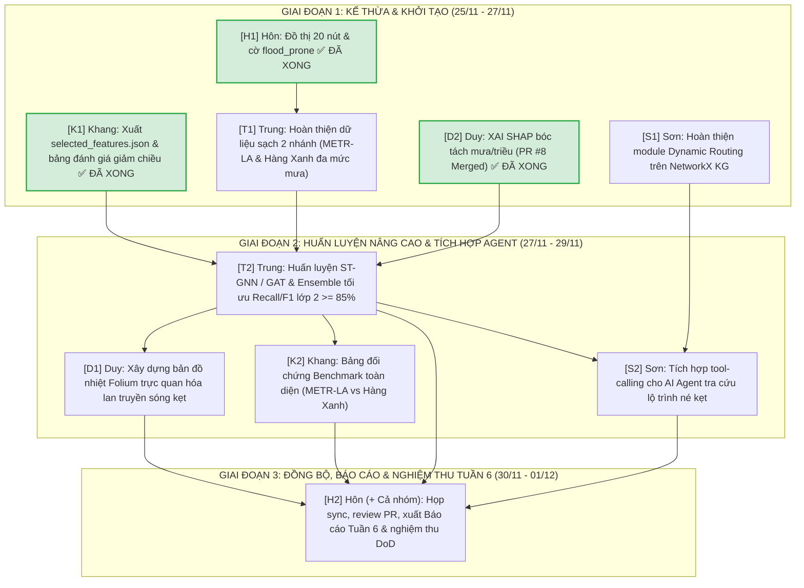

# KẾ HOẠCH THỰC HIỆN ĐỒ ÁN TUẦN 6 (25/11 – 01/12/2026)
## MÔN: MÁY HỌC NÂNG CAO (`CS315.G12.LT.TTNT`) — NHÓM 14

> **Khoảng thời gian:** Thứ Tư `25/11/2026` – Thứ Ba `01/12/2026` (Tuần 6 — Tối ưu Mô hình Đồ thị/Ensemble, Khai thác XAI SHAP & Thử nghiệm AI Agent)  
> **Tài liệu tham chiếu:** [De_Cuong_Chi_Tiet_Do_An_May_Hoc_Nang_Cao.md](./De_Cuong_Chi_Tiet_Do_An_May_Hoc_Nang_Cao.md) | [Ke_Hoach_Thuc_Hien_Tuan_5.md](./Ke_Hoach_Thuc_Hien_Tuan_5.md) | [README.md](./README.md)  
> **Phạm vi tài liệu:** Bản kế hoạch hành động chi tiết của 5 thành viên trong Tuần 6; quy định rõ **Đầu vào (Inputs)**, trạng thái **Phụ thuộc (Chờ ai)**, **Sản phẩm bàn giao (Deliverables)** và **Lưu ý kỹ thuật khắt khe** bám sát Đề cương chi tiết và WBS môn học CS315.  
> **Mục tiêu trọng tâm Tuần 6:**  
> 1. **Nâng cấp mô hình đồ thị & Ensemble:** Huấn luyện kiến trúc đồ thị không gian - thời gian (ST-GNN / GAT) kết hợp mô hình Ensemble cây (LightGBM/XGBoost) nhằm tối ưu phân loại lớp 2 (kẹt nặng), đạt mục tiêu thiết kế $\text{Recall} \ge 85\%$ và $\text{F1-Score} \ge 80\%$.  
> 2. **Khai thác toàn diện XAI SHAP:** Đã hoàn tất sớm qua PR #8; tích hợp script `shap_analysis.py` và các biểu đồ Summary/Dependence/Force plots vào notebook huấn luyện tổng hợp `02_Model_Training.ipynb`; phối hợp nâng cấp mock data đa mức mưa để bóc tách ngưỡng mưa kích hoạt kẹt xe.  
> 3. **Hoàn thiện Dynamic Dijkstra & Traffic KG:** Mở rộng 20 nút trên NetworkX, cập nhật trọng số cạnh động theo xác suất kẹt xe $P(y=2)$ từ mô hình ML và lượng mưa dự báo.  
> 4. **Xây dựng prototype AI Agent (Tool-calling):** Thử nghiệm Agent gọi tool tra cứu lộ trình thay thế né ngập/né kẹt (`03_Traffic_KG_Agent_Demo.ipynb`), chuẩn bị nền tảng hoàn thiện ở Tuần 7.  
> 5. **Đồng bộ và tổng hợp báo cáo tiến độ tuần:** Họp sync nhóm, rà soát chéo code, duyệt PRs và lập Báo cáo Tuần 6 (`05_report_slides/Bao_Cao_Tuan_6.docx`).

---

## I. SƠ ĐỒ PHỤ THUỘC ĐẦU VIỆC (AI LÀM LUÔN – AI CHỜ AI?)

---

## II. BẢNG TIẾN ĐỘ THỰC TẾ TUẦN 6 (TÍNH ĐẾN 25/11/2026)

| Mã CV | Thành viên phụ trách | Hạn chót | Tiến độ | Trạng thái thực tế & Ghi chú kỹ thuật |
| :---: | :--- | :---: | :---: | :--- |
| **`[D2]`** | **Vũ Văn Duy** | `25/11` | **`100%`** | **✅ ĐÃ HOÀN THÀNH SỚM (PR #8 MERGED 25/11/2026):** Triển khai `shap_analysis.py`, đo lường đóng góp nhóm Mưa (25–34%) cho lớp 2 trên LightGBM/RF, xuất 18 artifacts biểu đồ/bảng số liệu và tài liệu `shap_analysis_notes.md`. |
| **`[H1]`** | **Trần Hoàng Hôn** | `25/11` | **`100%`** | **✅ ĐÃ HOÀN THÀNH:** Bộ đồ thị 20 nút, 38 cạnh kèm cờ `flood_prone` và ma trận kề chuẩn hóa đã push lên `main` GitHub (commit `fe4191c`). Sẵn sàng làm input cho ST-GNN. |
| **`[T1]`** | **Phạm Thành Trung** | `27/11` | `50%` | **Đang thực hiện:** Chuẩn bị tập dữ liệu đối chứng `METR-LA` chuẩn hóa mốc 15 phút và bổ sung kịch bản đa mức mưa (`5/15/30/50 mm/h`) cho nhánh Hàng Xanh. |
| **`[K1]`** | **Nguyễn Duy Khang** | `27/11` | **`100%`** | **✅ ĐÃ HOÀN THÀNH (25/11/2026):** Ghép cờ `flood_prone` của `[H1]` vào pipeline (đạt $\chi^2 \approx 76 > 5.99$ ở cả 3 mốc). Xuất `selected_features.json` gồm `selected` (30/32 cột, cho cây + SHAP), `selected_compact` (27 cột, bỏ 3 biến đa cộng tuyến có $\lvert r \rvert \ge 0.9$, không bỏ biến mưa/triều) và phần chia `stgnn.dynamic`/`static`. Xuất `feature_importance_ranking.csv` (Mutual Information theo fold, kèm đối chiếu SHAP). Hoàn thiện notebook `01_Feature_Selection.ipynb` và smoke test. Nhánh PCA giảm 40,6% số chiều. **`[T2]` đã được mở khóa phần đặc trưng.** |
| **`[S1]`** | **Hoàng Cao Sơn** | `27/11` | `80%` | **Đang hoàn thiện:** Module đồ thị tri thức NetworkX 24 nút với trọng số phạt ngập/kẹt động; sẵn sàng đóng gói làm Tool cho AI Agent. |
| **`[T2]`** | **Phạm Thành Trung** | `29/11` | `0%` | **Chờ dữ liệu & đặc trưng:** Huấn luyện ST-GNN / GAT kết hợp Ensemble; tối ưu trọng số lớp mất cân bằng để đạt `Recall >= 85%` & `F1 >= 80%` tại $t+15', t+30', t+60'$. |
| **`[D1]`** | **Vũ Văn Duy** | `29/11` | `30%` | **Sẵn sàng thực hiện:** Nâng cấp bản đồ GIS Folium với timeline tương tác biểu diễn sóng lan truyền kẹt xe giữa các nút. |
| **`[S2]`** | **Hoàng Cao Sơn** | `29/11` | `20%` | **Chờ kết quả ML:** Xây dựng notebook `03_Traffic_KG_Agent_Demo.ipynb` thử nghiệm Agent gọi tool tìm lộ trình thông minh. |
| **`[K2]`** | **Nguyễn Duy Khang** | `30/11` | `0%` | **Chờ mô hình:** Tổng hợp bảng so sánh Benchmark toàn diện giữa Baseline ML và ST-GNN trên 2 nhánh dữ liệu (`METR-LA` vs Hàng Xanh). |
| **`[H2]`** | **Trần Hoàng Hôn** | `01/12` | `0%` | **Chờ PRs:** Họp sync tuần, rà soát chéo chất lượng code, duyệt PRs và đóng gói Báo cáo Tuần 6 (`05_report_slides/Bao_Cao_Tuan_6.docx`). |

---

## III. MA TRẬN PHỤ THUỘC TỔNG HỢP GIỮA 5 THÀNH VIÊN

| Thành viên | MSSV | Đầu việc làm được NGAY (Không chờ ai) | Đầu việc PHẢI CHỜ người khác | Vai trò mở khóa cho người sau |
| :--- | :---: | :--- | :--- | :--- |
| **Trần Hoàng Hôn** *(Trưởng nhóm / PM)* | `26410046` | **`[H1]`** *(✅ ĐÃ XONG)*: Đồ thị 20 nút sạch lỗi; điều phối chung tiến độ | • **`[H2]`** (họp sync, duyệt PRs và xuất báo cáo: chờ `[T2]`, `[K2]`, `[S2]`, `[D1]` nộp trước `30/11`) | **`[H1]` mở khóa đồ thị** cho Trung huấn luyện ST-GNN (`[T2]`). |
| **Phạm Thành Trung** *(Kỹ sư AI & ST-GNN)* | `26410141` | **`[T1]`** (hoàn tất script chuẩn hóa 2 nhánh dữ liệu sạch: METR-LA + Hàng Xanh đa mức mưa) | • **`[T2]`** (huấn luyện ST-GNN & Ensemble: chờ tập đặc trưng đã chọn lọc từ `[K1]`) | **`[T2]` là nút mở khóa trung tâm** cung cấp vector xác suất kẹt xe cho Sơn (`[S2]`), Duy (`[D1]`) và Khang (`[K2]`). |
| **Nguyễn Duy Khang** *(Dữ liệu & Benchmark)* | `26410055` | **`[K1]`** *(✅ ĐÃ XONG)*: chốt `selected_features.json` từ kết quả $\chi^2 > 5.99$ | • **`[K2]`** (chờ kết quả thực nghiệm `[T2]` để tổng hợp bảng Benchmark) | **`[K1]` mở khóa** cấu hình đặc trưng cho Trung (`[T2]`). |
| **Vũ Văn Duy** *(XAI & GIS Heatmap)* | `26410031` | **`[D2]`** *(✅ ĐÃ XONG)*: Phân tích XAI SHAP hoàn tất trong PR #8 | • **`[D1]`** (chờ ma trận xác suất theo thời gian từ `[T2]` để render heatmap lan truyền) | **`[D2]` cung cấp giải thích XAI** cho báo cáo tuần và chương thực nghiệm đồ án. |
| **Hoàng Cao Sơn** *(Traffic KG & AI Agent)* | `25730061` | **`[S1]`** (hoàn thiện hàm Dynamic Dijkstra phạt ngập/kẹt trên NetworkX) | • **`[S2]`** (chờ kết quả dự báo của `[T2]` để tích hợp LLM Tool-calling) | **`[S1]` & `[S2]` hoàn thiện AI Agent**, sẵn sàng chạy demo hỏi đáp lộ trình. |

---

## IV. KẾ HOẠCH CHI TIẾT TỪNG THÀNH VIÊN (25/11 – 01/12/2026)

### 1. Trần Hoàng Hôn (`26410046`) — Trưởng nhóm / PM & Quản trị tiến độ *(Lead WBS-02)*
*Định mức đồ án CS315 Tuần 6: ~2.5–3.0 giờ | Đảm bảo tính nhất quán dữ liệu và kỷ luật nộp báo cáo*

| Mã CV & Hạn | Đầu việc Đồ án | Đầu vào (Inputs) | Chờ người khác hoàn thành? | Sản phẩm bàn giao (Deliverables) |
| :--- | :--- | :--- | :--- | :--- |
| **`[H1]`** 25/11 *(✅ Đã xong)* | Nghiệm thu và đẩy lên GitHub đồ thị Hàng Xanh 20 nút, 38 cạnh có cờ `flood_prone` | • Script `extract_hang_xanh_graph.py` • File đồ thị `nodes.csv`, `edges.csv`, `adjacency_matrix.csv`, `hang_xanh.graphml` | **Đã hoàn tất (commit `fe4191c`).** | • Bộ dữ liệu đồ thị chuẩn hóa hoàn toàn trên GitHub nhánh `main`. |
| **`[H2]`** 30/11 – 01/12 | Điều phối họp sync Tuần 6, duyệt Pull Requests & xuất Báo cáo Tuần 6 | • Toàn bộ sản phẩm bàn giao của 4 thành viên (`[T2]`, `[K2]`, `[D1]`, `[S2]`) • Script tạo văn bản `05_report_slides/generate_report_docx.py` | **Chờ 4 thành viên nộp PRs trước tối 30/11.** *Lưu ý:* Kiểm tra chặt chẽ việc không rò rỉ dữ liệu, đảm bảo mã nguồn có unit test/smoke test và đường dẫn file là tương đối trong repo. | • Toàn bộ PRs Tuần 6 được merge sạch lên nhánh `main` GitHub. • Tài liệu Báo cáo Tuần 6 hoàn chỉnh: `05_report_slides/Bao_Cao_Tuan_6.docx`. • Cập nhật file tiến độ `Ke_Hoach_Thuc_Hien_Do_An_May_Hoc_Nang_Cao.xlsx` đạt 100% Tuần 6. |

---

### 2. Phạm Thành Trung (`26410141`) — Kỹ sư AI & Mô hình hóa ST-GNN / Ensemble
*Định mức đồ án CS315 Tuần 6: ~3.0–3.5 giờ | Nâng cấp kiến trúc mô hình đạt chuẩn thiết kế đề cương*

| Mã CV & Hạn | Đầu việc Đồ án | Đầu vào (Inputs) | Chờ người khác hoàn thành? | Sản phẩm bàn giao (Deliverables) |
| :--- | :--- | :--- | :--- | :--- |
| **`[T1]`** 25/11 – 27/11 | Hoàn thiện dữ liệu sạch 2 nhánh: METR-LA đối chứng & Hàng Xanh đa mức mưa | • Dataset benchmark `METR-LA` • Script sinh dữ liệu `build_mock_hang_xanh_dataset.py` nâng cấp đa mức mưa (`5, 15, 30, 50 mm/h`) theo đề xuất của Duy | **Làm được ngay.** *Lưu ý kỹ thuật:* Đảm bảo không đổi tên cột để tương thích ngược với pipeline hiện có. | • `01_data_sample/metr_la_sample.csv` (chuẩn hóa 15 phút). • `01_data_sample/mock_hang_xanh_multi_rain.csv` có nhiều mức mưa phục vụ tìm ngưỡng SHAP. |
| **`[T2]`** 27/11 – 29/11 | Huấn luyện mô hình đồ thị không gian - thời gian (ST-GNN/GAT) kết hợp Ensemble | • Ma trận kề chuẩn hóa $A$ và bảng đặc trưng `nodes.csv`, `edges.csv` từ `[H1]` • File đặc trưng tối ưu `selected_features.json` từ `[K1]` • Dữ liệu sạch từ `[T1]` | **CHỜ `[K1]` của Khang và `[T1]`.** *Lưu ý kỹ thuật:* (1) Áp dụng `class_weight='balanced'` hoặc `Focal Loss` để xử lý mất cân bằng lớp kẹt nặng; (2) Tối ưu siêu tham số đạt mục tiêu `Recall >= 85%` và `F1 >= 80%` tại cả 3 horizons; (3) Lưu trọng số model vào `03_models_evaluation/weights/`. | • Notebook huấn luyện `03_models_evaluation/02_Model_Training.ipynb` chạy mượt mà. • File trọng số `.joblib` / `.pt` đã lưu. • Bảng kết quả `03_models_evaluation/results/stgnn_vs_baseline_metrics.csv`. |

---

### 3. Nguyễn Duy Khang (`26410055`) — Kỹ sư Dữ liệu & Benchmark Evaluation
*Định mức đồ án CS315 Tuần 6: ~2.5–3.0 giờ | Đóng gói chọn đặc trưng và đo lường đối chứng khoa học*

| Mã CV & Hạn | Đầu việc Đồ án | Đầu vào (Inputs) | Chờ người khác hoàn thành? | Sản phẩm bàn giao (Deliverables) |
| :--- | :--- | :--- | :--- | :--- |
| **`[K1]`** 25/11 – 27/11 *(✅ Đã xong)* | Đóng gói kết quả Feature Selection chính thức và xuất cấu hình đặc trưng | • Notebook `02_feature_selection/01_Feature_Selection.ipynb` • Dữ liệu đã gán nhãn `flood_prone` từ `[H1]` | **Làm được ngay.** *Lưu ý kỹ thuật:* Áp dụng đúng ngưỡng $\chi^2 > 5.99$, bảo toàn các biến thời tiết phi tuyến, loại bỏ các biến có $r$ quá cao gây đa cộng tuyến nếu cần. | • File `02_feature_selection/results/selected_features.json`. • Bảng tổng hợp mức độ quan trọng `02_feature_selection/results/feature_importance_ranking.csv`. |
| **`[K2]`** 29/11 – 30/11 | Xây dựng bảng đối chứng Benchmark toàn diện (METR-LA vs Hàng Xanh; Baseline vs GNN) | • Kết quả đo đạc thực nghiệm từ `[T2]` • Các độ đo: Macro-F1, Recall lớp 2, PR-AUC, MAE/RMSE | **CHỜ `[T2]` của Trung.** *Lưu ý kỹ thuật:* Trình bày rõ tính ưu việt của việc bổ sung đồ thị và dữ liệu thời tiết so với mô hình chuỗi thời gian đơn lẻ. | • Bảng tổng hợp Benchmark `03_models_evaluation/results/benchmark_comparison_table.csv`. • Đoạn phân tích chuyên sâu cho Chương 4 Báo cáo đồ án. |

---

### 4. Vũ Văn Duy (`26410031`) — Kỹ sư Giải thích XAI & GIS Heatmap
*Định mức đồ án CS315 Tuần 6: ~2.5–3.0 giờ | Khai thác XAI và trực quan hóa động thái lan truyền*

| Mã CV & Hạn | Đầu việc Đồ án | Đầu vào (Inputs) | Chờ người khác hoàn thành? | Sản phẩm bàn giao (Deliverables) |
| :--- | :--- | :--- | :--- | :--- |
| **`[D2]`** 25/11 *(✅ Đã xong)* | Phân tích SHAP TreeExplainer bóc tách định lượng tác động của mưa và triều cường | • Model LightGBM/RF từ `[T3]` Tuần 5 • Dữ liệu `mock_hang_xanh_traffic_weather.csv` | **Đã hoàn tất sớm (PR #8 Merged 25/11).** | • Toàn bộ script `shap_analysis.py`, 18 biểu đồ/bảng CSV trong `results/shap/` và báo cáo `shap_analysis_notes.md`. |
| **`[D1]`** 27/11 – 29/11 | Xây dựng bản đồ nhiệt Folium tương tác trực quan hóa lan truyền sóng ùn tắc | • File đồ thị `nodes.csv`, `edges.csv` từ `[H1]` • Vector xác suất kẹt xe $P(y=2)$ theo chuỗi thời gian từ `[T2]` | **Làm khung trước; nhận vector dự báo từ `[T2]`.** *Lưu ý kỹ thuật:* Sử dụng `folium.plugins.TimestampedGeoJson` hoặc heatmap slider để biểu diễn sóng kẹt xe lan truyền qua các mốc 15 phút khi trời mưa lớn. | • Bản đồ tương tác HTML `01_data_sample/hang_xanh_traffic_propagation_heatmap.html`. • Ảnh chụp trực quan đưa vào Báo cáo Tuần 6. |

---

### 5. Hoàng Cao Sơn (`25730061`) — Kỹ sư Đồ thị tri thức (`GraphRAG`) & AI Agent *(Lead WBS-03)*
*Định mức đồ án CS315 Tuần 6: ~2.5–3.0 giờ | Hiện thực hóa định tuyến thông minh và AI Agent Tool-calling*

| Mã CV & Hạn | Đầu việc Đồ án | Đầu vào (Inputs) | Chờ người khác hoàn thành? | Sản phẩm bàn giao (Deliverables) |
| :--- | :--- | :--- | :--- | :--- |
| **`[S1]`** 25/11 – 27/11 | Hoàn thiện thuật toán Dynamic Dijkstra phạt ngập và kẹt xe trên Traffic KG 24 nút | • Schema `traffic_kg_schema.py` đã kết nối đồ thị 20 nút `[H1]` • Trọng số phạt động: $w = \text{length} \times (1 + \alpha \cdot P(\text{kẹt}) + \beta \cdot \text{flood\_prone})$ | **Làm được ngay.** *Lưu ý kỹ thuật:* Hàm trả về danh sách nút lộ trình tối ưu và lý do chọn lộ trình (né điểm ngập nào). | • Module `04_knowledge_graph_demo/dynamic_routing.py` có hàm `find_optimal_route(start, end, weather_cond)`. |
| **`[S2]`** 28/11 – 30/11 | Xây dựng prototype AI Agent gọi Tool tra cứu lộ trình né kẹt (`Tool-calling Agent`) | • Module `dynamic_routing.py` từ `[S1]` • Mock LLM / LangChain / Function Calling prototype | **CHỜ `[S1]`.** *Lưu ý kỹ thuật:* Thiết kế prompt và tool schema chuẩn (`JSON Schema`) cho function `get_route_recommendation`. | • Notebook `04_knowledge_graph_demo/03_Traffic_KG_Agent_Demo.ipynb` chạy demo tương tác hỏi - đáp tìm đường khi mưa ngập. |

---

## V. CHECKLIST NGHIỆM THU TUẦN 6 (`DEFINITION OF DONE` — HẠN `01/12/2026`)

- [x] **1. Phân tích XAI SHAP ([D2]):** Hoàn thành xuất sắc và vượt tiến độ; đo lường được đóng góp của mưa đạt 25–34% cho lớp kẹt nặng, xuất đủ 18 artifacts biểu đồ/bảng số liệu (✅ ĐÃ XONG - PR #8 Merged 25/11).
- [ ] **2. Dữ liệu & Lựa chọn đặc trưng ([T1], [K1]):**
  - [ ] Chuẩn hóa tập đối chứng `METR-LA` về bước thời gian 15 phút.
  - [x] Xuất file cấu hình `selected_features.json` từ kết quả kiểm định $\chi^2 > 5.99$ và bảo toàn biến phi tuyến (✅ `[K1]` 25/11: kèm `feature_importance_ranking.csv`, tập rút gọn ST-GNN và notebook `01_Feature_Selection.ipynb`).
- [ ] **3. Huấn luyện mô hình ST-GNN & Ensemble ([T2], [K2]):**
  - [ ] Huấn luyện thành công mô hình đồ thị ST-GNN / GAT trên ma trận kề $A$ 20 nút.
  - [ ] Đạt mục tiêu thiết kế phân loại lớp 2 (kẹt nặng): $\text{Recall} \ge 85\%$ và $\text{F1-Score} \ge 80\%$ tại các mốc $t+15', t+30', t+60'$.
  - [ ] Xuất bảng so sánh Benchmark đối chứng toàn diện `stgnn_vs_baseline_metrics.csv`.
- [ ] **4. Trực quan hóa GIS Heatmap ([D1]):**
  - [ ] Bản đồ HTML Folium `hang_xanh_traffic_propagation_heatmap.html` hiển thị động thái lan truyền sóng ùn tắc theo trục thời gian khi mưa lớn.
- [ ] **5. Đồ thị tri thức & AI Agent ([S1], [S2]):**
  - [ ] Module `dynamic_routing.py` tìm được lộ trình né ngập hiệu quả trên đồ thị 24 nút.
  - [ ] Notebook `03_Traffic_KG_Agent_Demo.ipynb` demo thành công Agent gọi Tool tra cứu đường đi khi trời mưa.
- [ ] **6. Báo cáo & Đồng bộ GitHub ([H2] & Cả nhóm):**
  - [ ] Toàn bộ code và artifacts Tuần 6 được tạo Pull Request và merge 100% lên nhánh `main` GitHub (không lỗi xung đột, không link hỏng).
  - [ ] Xuất file Báo cáo Tuần 6 hoàn chỉnh: `05_report_slides/Bao_Cao_Tuan_6.docx` và cập nhật tiến độ Tuần 6 đạt 100%.
